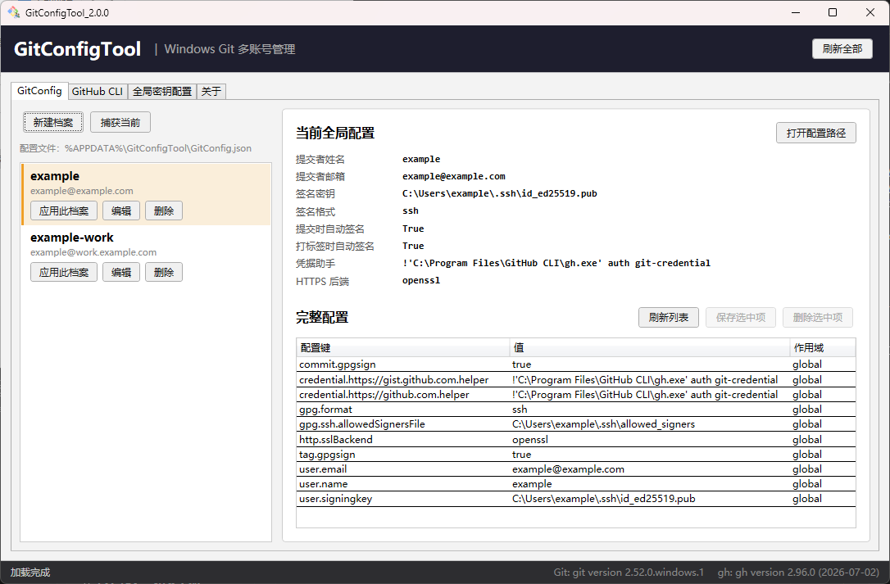

<div align="center">
<h1> Git Config Tool </h1>


> **Windows平台 `Git` 多账号快速切换工具**

> 把繁杂的命令通过GUI快速操作，提高效率，节省时间

[](https://www.microsoft.com/windows)
[](https://dotnet.microsoft.com/download/dotnet-framework)
[](https://learn.microsoft.com/dotnet/csharp/)
[](https://learn.microsoft.com/dotnet/desktop/wpf/)
[](LICENSE)

</div>

## 📷 截图展示



## 🌟 特色

| | |
| :---: | :--- |
| **Git多账号档案** | 把常用的 Git 身份存成档案，一键切换|
| **一键应用** | 把档案的 `user.name` / `user.email` / 签名配置写入全局 `.gitconfig`|
| **GitHub CLI 多账号** | 实时读取 `gh` 已登录账号，登录、切换、退出都在界面完成|
| **SSH 密钥管理** | 调用 `ssh-keygen` 生成密钥对，列表里可预览、编辑、删除|
| **签名白名单** | 创建 / 编辑 `allowed_signers`；「识别密钥项目」自动找出漏加的公钥与失效条目|

## 📚 环境要求

| 项 | 要求 |
|----|------|
| 系统 | Windows 10 / 11 |
| 运行时 | .NET Framework 4.8（系统一般已预装） |
| 必需 | Git for Windows |
| 可选 | GitHub CLI |

> [!TIP]
> 请确保 Git 安装在`默认位置`或已加入 `PATH` 环境变量

## ⬇️ 下载使用

[](https://github.com/NeetheCheeBao/GitConfigTool/releases)

## ⚙️ 工作原理

**Git 身份与签名**  `.gitconfig`（`%USERPROFILE%\.gitconfig`），本工具通过调用 `git config --global` 读写，不直接编辑文件，因此不会破坏配置格式

**提交签名链路**  私钥签名、公钥校验，两者靠 `allowed_signers` 白名单对应。本工具把这条链路串起来：生成密钥对 → 把公钥按「标识 算法 公钥」写进白名单 → 档案里配好签名密钥与格式 → 提交时由 `git` 调用 `ssh-keygen` 完成签名。**白名单里的「标识」必须和提交时的 `user.email` 一致，否则签名永远校验不过**

**GitHub CLI 账号** 的`token`存在Windows`凭据管理器`中，文本配置里只有"登录了哪些账号"。因此当前生效账号只能通过执行 `gh auth status` 读取，本工具不解析任何本地文件

**残留凭据清理**：`gh auth logout` 只删除配置，无法自动删除凭据库里的 token。本工具通过 Windows API（`CredEnumerate` / `CredDelete`）在启动时和退出后清理这些`无效凭据`

## 💾 数据存放

**档案数据**

```text
%APPDATA%\GitConfigTool\GitConfig.json
```

**工具读写的 Git 与 SSH 文件**

```text
%USERPROFILE%\.gitconfig              # 全局配置，应用档案时通过 git config --global 写入
%USERPROFILE%\.ssh\                   # 密钥对与签名白名单
```

> [!NOTE]
> `.gitconfig` 不直接编辑，全部通过 `git config --global` 读写，因此不会破坏配置格式

## 🔧 本地构建

1. 克隆仓库

```bash
git clone https://github.com/NeetheCheeBao/GitConfigTool.git
```

或者

```bash
gh repo clone NeetheCheeBao/GitConfigTool
```

2. 一键编译

```bash
.\build.bat
```

3. 检查产物：`bin\Release\GitConfigTool.exe`

## 📂 项目结构

```text
GitConfigTool
|   .gitignore                            # Git忽略配置
|   App.xaml                              # 应用入口：全局样式
|   App.xaml.cs                           # 应用类（仅声明）
|   build.bat                             # 一键构建脚本
|   GitConfigTool.csproj                  # 项目文件：net48 / WPF / 单 exe 配置
|   GitConfigTool.sln                     # Visual Studio 解决方案
|   LICENSE                               # 许可证
|   README.md                             # 自述文件
|   version.ini                           # 版本号：构建脚本与程序集共用
|   
+---assets                                # 静态资源
|       icon.ico                          # 程序图标
|       
+---helpers                               # 通用工具类
|       AppInfo.cs                        # 应用名称与版本（读程序集属性）
|       ButtonHover.cs                    # 按钮悬停/按下配色的附加属性
|       CredentialCleaner.cs              # 清理 gh 在系统凭据库里的残留 token
|       ExecutableLocator.cs              # 定位 git / gh 及 Git 自带工具的真实路径
|       FolderWatcher.cs                  # 目录监听：去抖 + 切回 UI 线程
|       PathDisplay.cs                    # 把绝对路径压缩成 %USERPROFILE% 等写法
|       RecycleBin.cs                     # 把文件移到回收站，而不是直接删除
|       RelayCommand.cs                   # ICommand 实现（同步 + 异步两个版本）
|       ShellHelper.cs                    # 资源管理器定位与剪贴板复制
|       SshKeyValidator.cs                # SSH 密钥与白名单的格式校验（纯内存）
|       
+---models                                # 数据模型
|       ConfigDisplayRow.cs               # 「当前全局配置」展示行
|       GitConfigItem.cs                  # 单条 git config 项（键 / 值 / 作用域）
|       GithubAccount.cs                  # gh 账号（用户名 / 主机 / 是否生效）
|       GitProfile.cs                     # Git 账号档案（身份 + 签名 + 凭据配置）
|       LogEntry.cs                       # 命令记录条目 + 日志类型枚举（决定颜色）
|       SshFileEntry.cs                   # SSH 目录里的单个文件（名称 / 类型 / 大小）
|       SshKeyPairContent.cs              # 密钥对的文件路径与文本内容
|       SshKeyRequest.cs                  # 创建密钥对的输入参数
|       SshListEntry.cs                   # SSH 列表条目（密钥对 / 白名单 / 占位）
|       SshWhitelistContent.cs            # 白名单文件的路径与文本内容
|       WhitelistReconcileItem.cs         # 白名单对账的单条待处理项
|       WhitelistReconcileResult.cs       # 白名单对账结果（分区展示）
|       
+---screenshot                            # 界面截图
|       demo1.png                         # 演示截图
|       
+---services                              # 业务服务层（对外部命令与文件的封装）
|       GithubCliService.cs               # gh 账号管理：状态解析 / 登录 / 切换 / 退出
|       GitService.cs                     # git 操作：配置读写 / 应用档案 / 读当前身份
|       ProfileStorageService.cs          # 档案持久化（手写 JSON 读写 + 旧文件迁移）
|       SshService.cs                     # SSH 密钥与白名单：列出 / 生成 / 读写 / 对账
|       
+---viewmodels                            # 视图模型
|       MainViewModel.cs                  # 主视图模型：初始化与全部命令
|       
\---views                                 # 视图（窗口与对话框）
        MainWindow.xaml                   # 主窗口：四个标签页的全部界面
        MainWindow.xaml.cs                # 窗口事件回调、命令记录着色渲染
        ProfileEditWindow.xaml            # 档案编辑对话框（身份 / 签名 / 凭据字段）
        ProfileEditWindow.xaml.cs         # 保存前校验必填项
        SshKeyCreateWindow.xaml           # 创建密钥对话框（名称 / 算法 / 标识）
        SshKeyCreateWindow.xaml.cs        # 参数校验后调用 ssh-keygen
        SshKeyViewWindow.xaml             # 密钥内容窗口（私钥 + 公钥，可编辑）
        SshKeyViewWindow.xaml.cs          # 预览 / 编辑两种模式，保存前校验
        SshWhitelistWindow.xaml           # 白名单内容窗口（单框，可编辑）
        SshWhitelistWindow.xaml.cs        # 保存前校验每行格式
        WhitelistReconcileWindow.xaml     # 白名单对账窗口（勾选后一次应用）
        WhitelistReconcileWindow.xaml.cs  # 应用勾选的新增与删除
```

## ⭕ 已知限制

- `gh auth switch` 是**全局**切换，`gh` 不支持按仓库指定账号
- 切换 GitHub 账号**不会**联动切换 Git 提交身份，两者是独立配置
- 本工具只管理全局配置，不读写仓库级 `.git/config`
- 退出 GitHub 账号只删除Windows本地凭据，不会吊销服务端授权
- Git / GitHub CLI 只按「注册表 / `where.exe` / PATH」定位，安装在自定义目录且未加入 PATH 时无法找到
- 私钥密码（passphrase）暂未开放，生成的私钥均为明文存储
- 密钥与白名单的**配对关系不做校验**：工具不解密私钥，只做格式检查（PEM 头尾 / base64 / `openssh-key-v1` 魔数），改了私钥后需自行确认公钥是否同步
- 「使用中」的判断基于「应用档案」实际会写入的配置项；档案里留空的项（`gpg.format` / `credential.helper` / `http.sslBackend`）代表「不修改」，因此不参与比对
- 「识别密钥项目」把「白名单里有、本机找不到对应密钥」一律列为待处理项。**白名单里放同事的公钥属于正常情况**，这类条目默认不勾选删除，删之前请自行确认

## ⚖️ 许可证

本项目采用 MIT 许可证 - 详情请参阅 [LICENSE](LICENSE) 文件